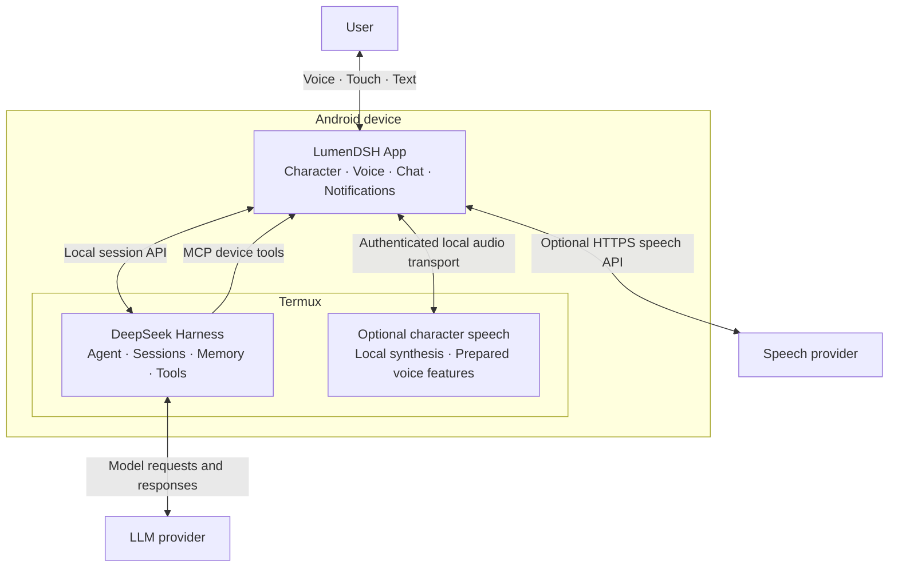

# LumenDSH

[English](README.md) | [简体中文](README.zh-CN.md)

A voice-first Android AI companion with an animated character home screen, persistent
memory and proactive activities. Powered by [DeepSeek Harness](https://github.com/deepseek-ai/deepseek-harness)
running independently in Termux.

▶ [Watch the real-device demo on Bilibili](https://www.bilibili.com/video/BV1AknU6hEyh/) (Chinese)

LumenDSH succeeds [Lumen](https://github.com/ydzat/lumen), bringing its personal-assistant
and companionship direction to a DSH-based Android client.

## Features

- **Character home screen** — a cyber habitat with animated pets, touch interactions,
  pinch-to-zoom and expandable text chat.
- **Voice interaction** — speech recognition and synthesis, local wake words,
  owner-speaker matching and a floating character overlay. Choose system speech,
  local hoyoTTS/GPT-SoVITS, or an HTTPS provider with selectable models and voices.
- **Grouped settings** — a side drawer with independent input/reply preferences; home voice sends when recognition finishes.
- **Long-term memory** — local semantic retrieval, memory consolidation and traceable sources.
- **Proactive assistance** — scheduled tasks and autonomous activities with configurable
  windows, budgets and pause controls.
- **One continuous Agent** — shared conversation and memory across daily assistance,
  tool use and self-improvement; model settings follow DSH's selected model.
- **Recoverable updates** — versioned content updates, phone-side APK builds and signed upgrades.

## Architecture

## Getting started

The current version is available as source. Setup requires:

- An Android 10+ device with Termux.
- A compatible DSH installation; the tested version is **0.2.1-rc.3**.
- An LLM provider configured in DSH.

1. Follow the [phone build guide](tooling/android-build/README.md) to prepare dependencies,
   build, sign and install the APK.
2. Configure the [local DSH connection](integrations/dsh/compatibility-rc3.md) and
   [device-tool pairing](integrations/device-tools/README.md).
3. Set up the [memory and companion integration](integrations/companion/README.md).
4. Choose your Agent name and appearance, configure voice, and enable autonomous
   activities if desired.

DSH and the build toolchain run separately from the APK. The client connects to DSH
on the same phone; LLM requests use the provider configured in DSH.

Tested on Huawei nova 5T / Android 10. Background voice, long-running behavior and
large memory libraries still need broader testing. See [project status](docs/project-status.md).

## Characters

The default appearance is fan art of **Silver Wolf from Honkai: Star Rail**, chosen
because she is the author's favorite character. You can rename your Agent and import
[compatible character packs](docs/design/m4-pet-format.md).

Artwork: [awesome-codex-pet / silver-wolf--lingxiaotian](https://github.com/legeling/awesome-codex-pet/tree/main/pets/silver-wolf--lingxiaotian),
licensed **CC BY-NC 4.0** according to its upstream submission. Appearance and voice
are configured separately.

[Voice provider setup](integrations/voice/providers.md) covers local models and
OpenAI-compatible remote speech. The evaluated CPUFast server offers Silver Wolf,
Firefly and Robin. Audio samples, voice features and model weights are **not included
in this repository or APK**.

## Documentation and support

- [Development guide](docs/README.md) · [Architecture](docs/architecture.md)
- [Dependencies](apps/android/DEPENDENCIES.md) · [Data and privacy](docs/data-and-publication.md)
- [Testing](tests/acceptance.md) · [Roadmap and status](docs/project-status.md)

Maintained by [ydzat](https://github.com/ydzat). Report bugs and suggest improvements
through [Issues](https://github.com/ydzat/LumenDSH/issues).

## Acknowledgments

Thanks to the upstream authors whose implementations and design work made this project possible:

- [DeepSeek Harness](https://github.com/deepseek-ai/deepseek-harness) and
  [Termux](https://github.com/termux/termux-app) — the Agent runtime and phone-side environment.
- [deepseek-harness-android](https://github.com/guzhou079-arch/deepseek-harness-android) —
  reused Android companion interactions, overlays, sharing, scheduling and release utilities.
- [dsh-pet](https://github.com/ysyyhhh/dsh-pet) — reused pet animation contract;
  [PC2005-cloud/dsh-pet](https://github.com/PC2005-cloud/dsh-pet),
  [Fairy-DSH](https://github.com/Chengzhibense/Fairy-DSH) and
  [fairy-stackchan](https://github.com/Michae1o/fairy-stackchan) — presentation and interaction references.
- [dsh-mnemon](https://github.com/omdsh-dev/dsh-mnemon) and
  [Mnemon](https://github.com/mnemon-dev/mnemon) — memory integration;
  [dsh-bili-whale](https://github.com/Alterssss/dsh-bili-whale) — reused activity planner;
  [dsh-whale-persona](https://github.com/linsport/dsh-whale-persona) and
  [Magic Context](https://github.com/cortexkit/magic-context) — companion and memory design references.
- [awesome-codex-pet](https://github.com/legeling/awesome-codex-pet) — the default character pack.
- [gpt-sovits-onnx-rs](https://github.com/bailu-obj/gpt-sovits-onnx-rs),
  [ort](https://github.com/pykeio/ort) and [ONNX Runtime](https://github.com/microsoft/onnxruntime) —
  reused local character speech inference; [pins and adaptations](integrations/voice/README.md).

Pinned revisions, licenses and adaptation details are recorded in
[dependency notes](apps/android/DEPENDENCIES.md),
[third-party notices](apps/android/assets/THIRD_PARTY_NOTICES.txt) and
[companion attribution](integrations/companion/upstream/NOTICE.md).

## License

Project code: [MIT](LICENSE). Third-party components and character assets retain
their own licenses; see [notices](apps/android/assets/THIRD_PARTY_NOTICES.txt).
