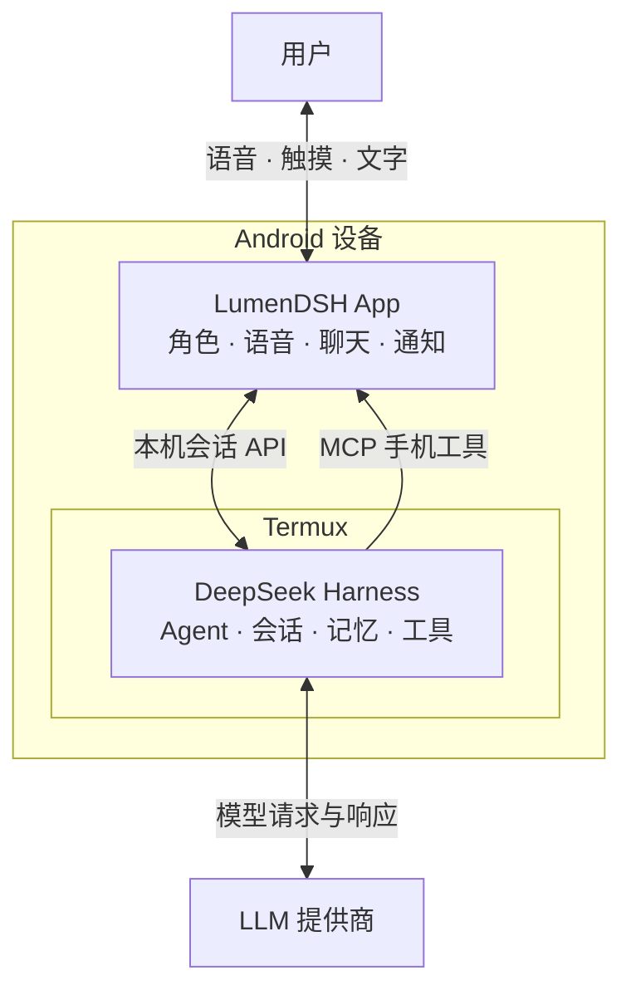

# LumenDSH

[English](README.md) | [简体中文](README.zh-CN.md)

以语音为主要交互方式的 Android AI 伴侣，提供动态角色主页、长期记忆和自主活动。
由手机 Termux 中独立运行的 [DeepSeek Harness](https://github.com/deepseek-ai/deepseek-harness) 驱动。

▶ [在 Bilibili 观看真机演示](https://www.bilibili.com/video/BV1AknU6hEyh/)

LumenDSH 承接并替代 [Lumen](https://github.com/ydzat/lumen)，延续个人 AI 助手与长期陪伴的方向，
以 DSH 为基础构建 Android 客户端。

## 功能

- **角色主页** — 动态桌宠与赛博空间，支持触摸互动、双指缩放和展开文字聊天。
- **语音交互** — 语音识别与合成、本地唤醒词、主人声纹匹配和悬浮角色。
- **长期记忆** — 本地语义检索、记忆整理与来源追溯。
- **主动协助** — 定时任务和自主活动，支持活动窗口、资源预算和暂停控制。
- **连续的 Agent 身份** — 日常协助、工具调用与自主改造共享会话和记忆，模型配置跟随 DSH。
- **可恢复更新** — 内容版本管理、手机端 APK 构建与签名升级。

## 顶层架构

## 开始使用

当前通过源码构建，需要准备：

- Android 10+ 设备及 Termux。
- 兼容的 DSH 环境，当前验证版本为 **0.2.1-rc.3**。
- 已在 DSH 中配置的 LLM 提供商。

1. 按[手机构建指南](tooling/android-build/README.md)准备依赖，构建、签名并安装 APK。
2. 配置[本机 DSH 连接](integrations/dsh/compatibility-rc3.md)和[手机工具配对](integrations/device-tools/README.md)。
3. 完成[记忆与伴侣后端配置](integrations/companion/README.md)。
4. 选择 Agent 名称与形象，配置语音，按需启用自主活动。

DSH 和构建工具链独立于 APK 运行。客户端连接同一手机上的 DSH，LLM 请求发送至 DSH 配置的提供商。

目前在 Huawei nova 5T / Android 10 上验证。后台语音、长期运行和大规模记忆库仍需更广泛测试，
详见[项目状态](docs/project-status.md)。

## 角色形象

默认形象是基于**《崩坏：星穹铁道》银狼角色的二创**，源于作者对该角色的喜爱。
你可以设置自己的 Agent 名称，并导入[兼容的角色资源包](docs/design/m4-pet-format.md)。

形象来源：[awesome-codex-pet / silver-wolf--lingxiaotian](https://github.com/legeling/awesome-codex-pet/tree/main/pets/silver-wolf--lingxiaotian)，
上游投稿声明许可为 **CC BY-NC 4.0**。外观与声音分别配置。

## 文档与反馈

- [开发指南](docs/README.md) · [架构](docs/architecture.md)
- [依赖说明](apps/android/DEPENDENCIES.md) · [数据与隐私](docs/data-and-publication.md)
- [测试与验收](tests/acceptance.md) · [计划与状态](docs/project-status.md)

由 [ydzat](https://github.com/ydzat) 维护。问题与建议请提交至 [Issues](https://github.com/ydzat/LumenDSH/issues)。

## 致谢

感谢以下开源项目作者的实现与设计工作：

- [DeepSeek Harness](https://github.com/deepseek-ai/deepseek-harness) 与
  [Termux](https://github.com/termux/termux-app)：Agent 运行时与手机端运行环境。
- [deepseek-harness-android](https://github.com/guzhou079-arch/deepseek-harness-android)：
  复用了 Android 角色交互、悬浮窗、分享、调度和发布工具中的实现。
- [dsh-pet](https://github.com/ysyyhhh/dsh-pet)：复用桌宠动画契约；
  [PC2005-cloud/dsh-pet](https://github.com/PC2005-cloud/dsh-pet)、
  [Fairy-DSH](https://github.com/Chengzhibense/Fairy-DSH) 和
  [fairy-stackchan](https://github.com/Michae1o/fairy-stackchan)：角色呈现与交互设计参考。
- [dsh-mnemon](https://github.com/omdsh-dev/dsh-mnemon) 与
  [Mnemon](https://github.com/mnemon-dev/mnemon)：记忆系统集成；
  [dsh-bili-whale](https://github.com/Alterssss/dsh-bili-whale)：复用自主活动规划器；
  [dsh-whale-persona](https://github.com/linsport/dsh-whale-persona) 与
  [Magic Context](https://github.com/cortexkit/magic-context)：伴侣行为与记忆设计参考。
- [awesome-codex-pet](https://github.com/legeling/awesome-codex-pet)：默认角色资源包。

具体版本、许可和适配记录见[依赖说明](apps/android/DEPENDENCIES.md)、
[第三方声明](apps/android/assets/THIRD_PARTY_NOTICES.txt)和
[伴侣代码来源](integrations/companion/upstream/NOTICE.md)。

## 许可

项目代码采用 [MIT](LICENSE)。第三方组件和角色素材保留各自许可，详见[第三方声明](apps/android/assets/THIRD_PARTY_NOTICES.txt)。
